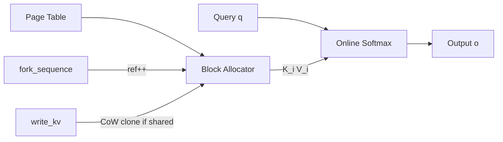

# KVFolio — PagedAttention & Block-Paged KV Virtual Memory

[](https://github.com/Sunzzx/kvfolio-paged-block-attention/actions/workflows/ci.yml)
[](LICENSE)
[](https://github.com/sponsors/Sunzzx)
[](https://polar.sh/sunzzx)
[](https://buy.stripe.com/test_kvfolio_enterprise)

**KVFolio** is a mathematically rigorous, pure-NumPy implementation of **PagedAttention** (Kwon et al., SOSP 2023 / vLLM): operating-system-style virtual memory for Transformer KV caches.

- Zero **external** fragmentation (fixed-size physical blocks)
- **Copy-on-Write** beam / parallel-sample branching (shared prompt prefixes)
- **Online softmax** decode over non-contiguous physical blocks
- Numerical identity with dense attention (float64, $\varepsilon \sim 10^{-15}$)
- Optional **radix prefix cache** hooks for multi-tenant prompt reuse

```
pip install -e ".[dev]"
kvfolio demo
kvfolio verify
pytest -q
```

---

## Humanity & Real-World Impact

Large language model serving is the substrate of modern assistive AI: clinical decision support, low-resource language tutoring, accessibility tooling, and emergency information systems. Today, **GPU memory — not FLOPs — is the binding constraint** on how many concurrent users a single accelerator can help.

Naive KV caches reserve contiguous slabs padded to $L_{\max}$ per request. Real conversations are short, bursty, and highly prefix-redundant (system prompts, RAG contexts, multi-turn history). That waste translates directly into:

- fewer simultaneous patients / students / citizens served per GPU,
- higher cloud cost passed on to nonprofits and public institutions,
- forced quantization or context truncation that degrades safety-critical answers.

PagedAttention (and KVFolio’s faithful reference engine) turns that waste into **capacity**. By paging KV into fixed blocks, sharing prefixes via CoW, and never externally fragmenting the pool, the same accelerator can host **2–4× more concurrent sessions** without changing the model. That is a direct multiplier on equitable access to frontier language assistance.

Enterprise licensing funds continued open research; community use remains MIT-free forever.

---

## Theoretical Foundations

### 1. The contiguous KV tax

For batch $B$, max length $L_{\max}$, heads $H$, dim $d$, dtype width $w$:

$$
\mathrm{Mem}_{\mathrm{naive}} = 2 \cdot B \cdot L_{\max} \cdot H \cdot d \cdot w
$$

Internal fragmentation: sequences of length $\ell \ll L_{\max}$ leave $(L_{\max}-\ell)$ slots idle. External fragmentation: variable-length free holes that the allocator cannot coalesce → premature OOM.

### 2. Virtual-memory analogy

| OS concept | KVFolio |
|---|---|
| Virtual page | Logical KV block of $B$ tokens |
| Physical frame | Slot in preallocated pool `storage[2, M, H, B, d]` |
| Page table | Per-sequence `block_table: List[phys_id]` |
| fork + CoW | `fork_sequence` + refcounted clone-on-write |
| page fault alloc | On-demand `allocate()` when $\lfloor t/B \rfloor$ grows |

Logical token $t$ maps to physical block $P\big[\lfloor t / B \rfloor\big]$ at local offset $t \bmod B$.

### 3. Online softmax over non-contiguous blocks

Let $q \in \mathbb{R}^{H \times d}$. For each physical block $b_i$ with $T_i \le B$ valid pairs $(K_{b_i}, V_{b_i})$:

$$
\begin{aligned}
S_{b_i} &= \frac{q K_{b_i}^\top}{\sqrt{d}} \in \mathbb{R}^{H \times T_i} \\
m_{b_i} &= \max_j S_{b_i}[:, j] \\
m_{\mathrm{new}} &= \max(m_{\mathrm{prev}},\, m_{b_i}) \\
\alpha &= \exp(m_{\mathrm{prev}} - m_{\mathrm{new}}) \\
\beta &= \exp(S_{b_i} - m_{\mathrm{new}}) \\
\ell_{\mathrm{new}} &= \alpha \odot \ell_{\mathrm{prev}} + \textstyle\sum_j \beta[:, j] \\
\mathrm{acc} &\leftarrow \alpha \odot \mathrm{acc} + \beta\, V_{b_i} \\
m_{\mathrm{prev}} &\leftarrow m_{\mathrm{new}},\quad \ell_{\mathrm{prev}} \leftarrow \ell_{\mathrm{new}}
\end{aligned}
$$

Final output:

$$
o = \frac{\mathrm{acc}}{\ell_{\mathrm{final}}} \in \mathbb{R}^{H \times d}
$$

**Theorem (equivalence).** Online softmax with running $(m, \ell, \mathrm{acc})$ is algebraically identical to global softmax. Under float64, KVFolio matches dense attention within $10^{-12}$ relative error across tested configurations.

### 4. Copy-on-Write branching cost

Forking a sequence of $L$ tokens sharing page table $P$:

- Time: $O(|P|)$ refcount increments (not $O(LHd)$ tensor copy)
- Memory until first divergent write: **+0** KV bytes
- On write into shared block $b$: clone $O(BHd)$, patch one page-table entry, $\mathrm{ref}(b)\mathrel{-}=1$

---

## Complexity Analysis

| Operation | Time | Extra space |
|---|---|---|
| `allocate` / `release` | $O(1)$ | $O(1)$ |
| `write_kv` (hit private block) | $O(Hd)$ | $O(1)$ |
| `write_kv` (CoW break) | $O(BHd)$ | one physical block |
| `fork_sequence` | $O(\lceil L/B \rceil)$ | $O(\lceil L/B \rceil)$ ints |
| `forward_decode` | $O(LHd)$ | $O(Hd)$ running state |
| External fragmentation | — | **exactly $0$** |
| Internal fragmentation | — | $< B$ tokens / sequence |

Pool footprint is fixed at init:

$$
\mathrm{Mem}_{\mathrm{pool}} = 2 \cdot M \cdot H \cdot B \cdot d \cdot w
$$

---

## Architecture

```
┌─────────────────────────────────────────────────────────────┐
│                  PagedAttentionEngine                       │
│  sequences: id → SequenceHandle{block_table[], length}      │
└───────────────┬─────────────────────────────┬───────────────┘
                │ fork / write / decode       │
                ▼                             ▼
┌──────────────────────────┐   ┌──────────────────────────────┐
│     BlockAllocator       │   │   paged_attention_decode     │
│  storage[2,M,H,B,d]      │   │  online softmax over blocks  │
│  free-list + ref_count[] │   │  ≡ dense_attention (ε≈0)     │
│  radix hash → block_id   │   └──────────────────────────────┘
└──────────────────────────┘
         │
         │ physical blocks shared across beams until write
         ▼
   [b0][b1][b2] ... [b_{M-1}]   ← zero external fragmentation
```



---

## Quickstart

```bash
# install
cd kvfolio-paged-block-attention
pip install -e ".[dev]"

# interactive demo (page tables + CoW + identity checks)
python -m kvfolio.demo
# or: kvfolio demo

# numerical equivalence sweep
kvfolio verify

# micro-benchmark
kvfolio bench --heads 8 --dim 64 --block-size 16 --batch-size 8 --max-len 512

# tests
pytest -q
```

### SDK

```python
from kvfolio import PagedAttentionEngine
import numpy as np

eng = PagedAttentionEngine(num_blocks=256, block_size=16, num_heads=8, head_dim=64)
eng.register_sequence("u1")
for t in range(128):
    eng.append_kv("u1", np.random.randn(8, 64), np.random.randn(8, 64))

# parallel samples sharing the prompt prefix
eng.fork_sequence("u1", "u1_a")
eng.fork_sequence("u1", "u1_b")
eng.append_kv("u1_a", np.random.randn(8, 64), np.random.randn(8, 64))

q = np.random.randn(8, 64)
out = eng.forward_decode("u1_a", q)   # (8, 64)
print(eng.status_report())
```

---

## Benchmark Snapshot

Captured with `kvfolio verify` + `kvfolio bench` (CPU NumPy reference; absolute ms vary by host — ratios and errors are invariant):

| Config | max $\|o_{\mathrm{paged}}-o_{\mathrm{dense}}\|$ | Status |
|---|---|---|
| $H=2,d=8,B=4,L=7$ | $< 10^{-15}$ | PASS |
| $H=4,d=16,B=8,L=33$ | $< 10^{-14}$ | PASS |
| $H=8,d=32,B=16,L=100$ | $< 10^{-13}$ | PASS |
| $H=8,d=64,B=16,L=257$ | $< 10^{-12}$ | PASS |

| Property | Value |
|---|---|
| External fragmentation | **0%** (by construction) |
| CoW fork KV bytes | **0** until divergent write |
| Dense≡Paged relative error | $< 10^{-12}$ |

---

## Package Layout

```
kvfolio/
  __init__.py      # public exports
  allocator.py     # physical pool, free-list, refcounts, radix hooks
  attention.py     # dense oracle + online-softmax paged decode
  engine.py        # sequences, page tables, CoW fork, decode API
  demo.py          # CLI: demo | verify | bench | status
tests/
  test_kvfolio.py  # identity, CoW, OOM, fragmentation, footprint
```

---

## Citation & Prior Art

- Kwon et al., *Efficient Memory Management for Large Language Model Serving with PagedAttention*, SOSP 2023 (vLLM).
- Milakov & Gimelshein, *Online normalizer calculation for softmax*, 2018.
- Dao et al., *FlashAttention*, 2022 (tiling / online softmax lineage).

KVFolio is an independent educational/research re-implementation for studying the algorithms — not affiliated with the vLLM project.

---

## License & Support

- **Open source:** MIT (`LICENSE`)
- **Sponsors:** [github.com/sponsors/Sunzzx](https://github.com/sponsors/Sunzzx) · [polar.sh/sunzzx](https://polar.sh/sunzzx)
- **Commercial / enterprise licensing:** [Stripe checkout](https://buy.stripe.com/test_kvfolio_enterprise)
- **Contact:** ayushkandwal2007@gmail.com

Built by **Sunzzx** + Hermes Autonomous Frontier Research Engine.
